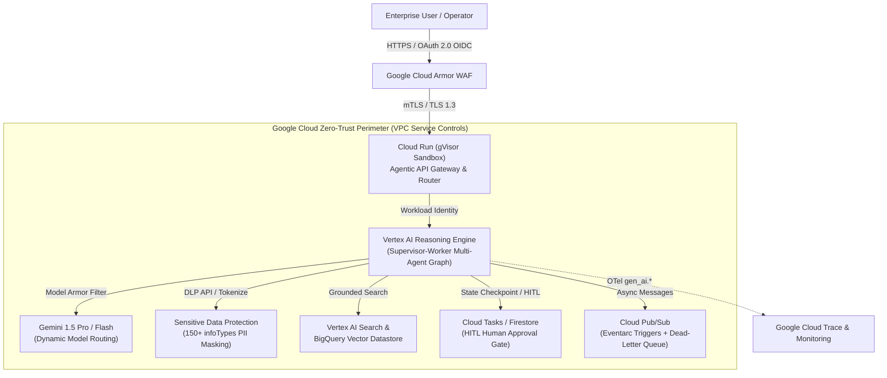
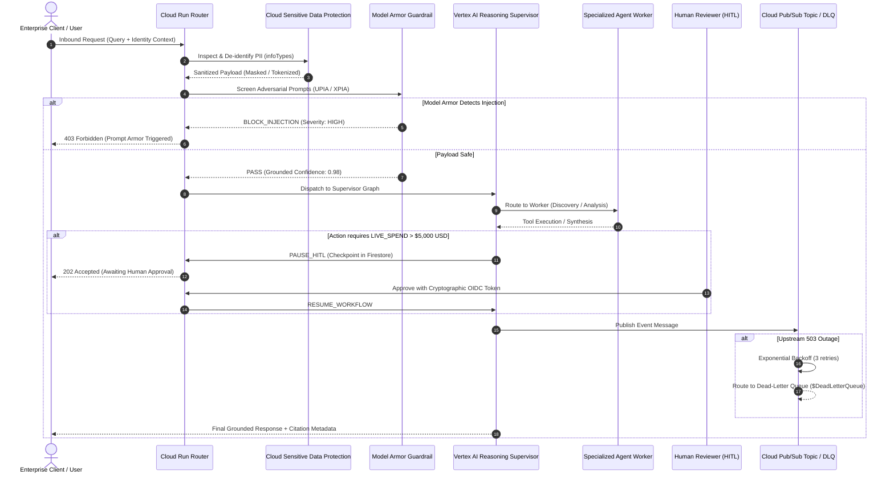

# Solution Architecture Document & Architectural Decision Records (ADRs)

## Google Cloud Professional Agentic Architect: Securing, Governing, and Orchestrating Enterprise Agentic Workflows

---

## 1. System Context & C4 Architecture (Mermaid)

### Level 1: System Context Diagram

### Level 2: Component Architecture & State Transitions

---

## 2. Google Cloud Architectural Decision Records (ADRs)

### ADR-01: Vertex AI Reasoning Engine vs. Custom Cloud Run LangGraph Containers
- **Context:** Enterprise multi-agent systems require scalable orchestration, deterministic routing, and sandboxed tool execution.
- **Decision:** Use a **Hybrid Architecture**: deploy Python agent graphs to **Vertex AI Reasoning Engine** for native Gemini function calling and SDK integration, containerized on **Cloud Run with gVisor sandbox** for custom external tool integrations requiring isolated system binaries.
- **Trade-offs:** Vertex AI Reasoning Engine offers managed scaling and direct Vertex integration, while Cloud Run provides custom environment flexibility and second-by-second billing.

### ADR-02: Workload Identity Federation & VPC Service Controls vs. Long-Lived Service Account Keys
- **Context:** Service account JSON keys pose critical security risks (accidental leaks, absence of automatic rotation, difficult revocations).
- **Decision:** Mandate **Keyless Workload Identity Federation** and short-lived OAuth 2.0 / OIDC tokens for all human and agent callers, enforced by **VPC Service Controls (VPC-SC)** perimeter security policies.
- **Consequences:** Eliminates static credential theft vectors; guarantees that even if an internal token is leaked, egress outside the VPC-SC perimeter is blocked at the network level.

### ADR-03: Google Cloud Sensitive Data Protection (DLP) Inline Tokenization vs. Post-Hoc Auditing
- **Context:** LLMs in enterprise customer service or financial analysis may ingest SSNs, credit cards, or internal project code names.
- **Decision:** Implement **Inline De-Identification** using Google Cloud Sensitive Data Protection prior to model context ingestion.
- **Consequences:** Zero raw PII reaches model prompt contexts or training logs; original values are stored in a secure cryptographic tokenization key store accessible only by authorized human reviewers.

### ADR-04: Asynchronous Cloud Pub/Sub Eventarc & DLQ vs. Synchronous REST Webhook Cascades
- **Context:** Multi-agent supply chain, order fulfillment, and ERP integrations experience transient network spikes and 429/503 rate limits.
- **Decision:** Decouple downstream mutations using **Cloud Pub/Sub Topics** with dead-letter queue (`$DeadLetterQueue`) subscriptions and exponential backoff retry policies.
- **Consequences:** Guarantees eventual consistency, self-healing retries for transient outages, and zero dropped messages during ERP maintenance windows.

---

## 3. STRIDE Threat Model & Google Cloud Security Controls

| STRIDE Category | Threat Vector | Google Cloud Mitigation Control | Verification Mechanism |
| :--- | :--- | :--- | :--- |
| **Spoofing** | Adversary impersonates an internal operator to trigger agent actions. | Workload Identity Federation + Short-Lived OIDC JWT Tokens + IAM Least Privilege. | Unit tests verify rejected unauthenticated or invalid tokens. |
| **Tampering** | Prompt injection (UPIA / XPIA) alters tool call parameters. | Google Cloud Model Armor + Pydantic v2 strict input schema validation. | Model Armor test suite with 6 adversarial probe vectors. |
| **Repudiation** | Operator denies authorizing a high-value financial disbursement. | Immutable Cloud Audit Logging + Cryptographic SHA-256 HMAC Signatures. | Audit trail verification test confirming tamper-evident hash. |
| **Information Disclosure** | Unauthorized user extracts confidential data via ungrounded RAG. | Pre-retrieval Dataplex policy tags + Cloud Sensitive Data Protection (DLP) infoType masking. | DLP unit test verifying masking of email, SSN, and API keys. |
| **Denial of Service** | Unbounded agent recursion or token flood exhausts quota/budget. | Cloud Armor rate limiting + Cloud Monitoring FinOps token quota limits + LangGraph recursion bounds. | Cloud Monitoring quota test confirming budget alerting. |
| **Elevation of Privilege** | Agent uses local tool execution privileges to access external VPC endpoints. | VPC Service Controls perimeter + Cloud Run gVisor kernel sandboxing. | VPC-SC perimeter access policy validation test. |
