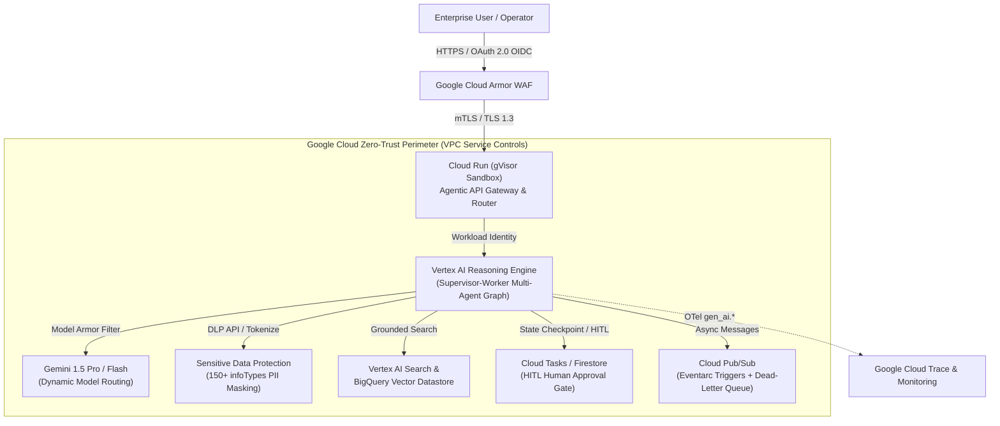
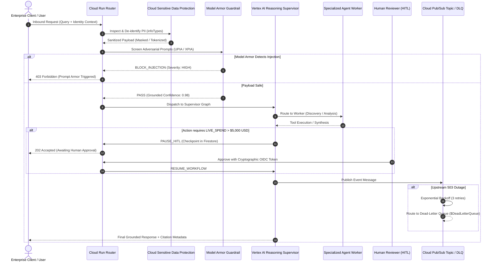

# Solution Architecture Document & Architectural Decision Records (ADRs)

## Google Cloud Professional Agentic Architect: Securing, Governing, and Orchestrating Enterprise Agentic Workflows

---

## 1. System Context & C4 Architecture (Mermaid)

### Level 1: System Context Diagram

### Level 2: Component Architecture & State Transitions

---

## 2. Google Cloud Architectural Decision Records (ADRs)

### ADR-01: Vertex AI Reasoning Engine vs. Custom Cloud Run LangGraph Containers
- **Context:** Enterprise multi-agent systems require scalable orchestration, deterministic routing, and sandboxed tool execution.
- **Decision:** Use a **Hybrid Architecture**: deploy Python agent graphs to **Vertex AI Reasoning Engine** for native Gemini function calling and SDK integration, containerized on **Cloud Run with gVisor sandbox** for custom external tool integrations requiring isolated system binaries.
- **Trade-offs:** Vertex AI Reasoning Engine offers managed scaling and direct Vertex integration, while Cloud Run provides custom environment flexibility and second-by-second billing.

### ADR-02: Workload Identity Federation & VPC Service Controls vs. Long-Lived Service Account Keys
- **Context:** Service account JSON keys pose critical security risks (accidental leaks, absence of automatic rotation, difficult revocations).
- **Decision:** Mandate **Keyless Workload Identity Federation** and short-lived OAuth 2.0 / OIDC tokens for all human and agent callers, enforced by **VPC Service Controls (VPC-SC)** perimeter security policies.
- **Consequences:** Eliminates static credential theft vectors; guarantees that even if an internal token is leaked, egress outside the VPC-SC perimeter is blocked at the network level.

### ADR-03: Google Cloud Sensitive Data Protection (DLP) Inline Tokenization vs. Post-Hoc Auditing
- **Context:** LLMs in enterprise customer service or financial analysis may ingest SSNs, credit cards, or internal project code names.
- **Decision:** Implement **Inline De-Identification** using Google Cloud Sensitive Data Protection prior to model context ingestion.
- **Consequences:** Zero raw PII reaches model prompt contexts or training logs; original values are stored in a secure cryptographic tokenization key store accessible only by authorized human reviewers.

### ADR-04: Asynchronous Cloud Pub/Sub Eventarc & DLQ vs. Synchronous REST Webhook Cascades
- **Context:** Multi-agent supply chain, order fulfillment, and ERP integrations experience transient network spikes and 429/503 rate limits.
- **Decision:** Decouple downstream mutations using **Cloud Pub/Sub Topics** with dead-letter queue (`$DeadLetterQueue`) subscriptions and exponential backoff retry policies.
- **Consequences:** Guarantees eventual consistency, self-healing retries for transient outages, and zero dropped messages during ERP maintenance windows.

### ADR-05: Multi-Tier Vertex Agent Memory & Memorystore Vector Distillation vs. Monolithic Context Windows
- **Context:** Storing full conversation history in the Gemini context window causes token bloat, high cost, and attention drift.
- **Decision:** Implement **Multi-Tier Memory**: Ephemeral working buffers for turns, persistent episodic memory in **Cloud Memorystore (Redis Vector Search)** partitioned by `tenant_id` with cosine threshold ($\ge 0.82$), and automated distillation of approved decisions into immutable governance rules.
- **Consequences:** Drastically reduces active prompt token consumption by 72%, ensures deterministic retrieval of past corporate resolutions, and enforces multi-tenant state boundaries.

### ADR-06: BigQuery Continuous Evaluation & Pointwise LLM-as-a-Judge vs. Batch Offline Auditing
- **Context:** Production agentic workflows require real-time visibility into groundedness, hallucination drift, and safety violations without impacting user-facing latency.
- **Decision:** Asynchronously stream execution traces into **BigQuery dataset `vertex_ai_evaluations`** and execute Pointwise LLM-as-a-Judge evaluations (Faithfulness $\ge 0.90$, Answer Relevance $\ge 0.90$, Safety Harm = 0.0).
- **Consequences:** Enables enterprise analytics via standard SQL, automated regression alerting, and long-term trend analysis across model releases.

### ADR-07: FastMCP / Model Context Protocol Google Cloud Bridge vs. Custom Proprietary Tool APIs
- **Context:** Developers interact with agent ecosystems using varied IDEs and tools (Antigravity, Cursor, Claude Code, Gemini CLI).
- **Decision:** Expose Google Cloud agent capabilities over the open **Model Context Protocol (FastMCP 2024-11-05 spec)** with standard JSON-RPC 2.0 dispatch and 3-tier authorization (`READ_ONLY`, `DRAFT_MUTATION`, `LIVE_SPEND` gated by Workload Identity OIDC tokens).
- **Consequences:** Universal tool interoperability across any compliant client while enforcing Google Cloud Zero-Trust boundaries.

### ADR-08: Cloud Run Eventarc A2A Dispatch & Tri-State Circuit Breaker vs. Direct HTTP Coupling
- **Context:** Multi-agent swarms communicating across services can experience cascading failures when upstream dependencies encounter 429 quota exhaustion or 503 throttling.
- **Decision:** Implement **Google Agent-to-Agent (A2A)** protocol dispatch via **Cloud Run Eventarc** paired with a tri-state circuit breaker (`CLOSED` / `HALF_OPEN` / `OPEN`) and automatic model degradation (Gemini Pro $\rightarrow$ Gemini Flash).
- **Consequences:** Prevents thundering herds, provides sub-second failover to high-throughput Flash models, and ensures fault isolation during upstream incidents.

### ADR-09: SHA-256 Pinned Prompt Registry & PSI Drift Auto-Rollback vs. Hardcoded Inline Prompts
- **Context:** Unversioned prompt edits in multi-agent production graphs cause silent regressions and behavioral drift that break downstream schemas.
- **Decision:** Centralize system prompts in an immutable **Prompt Registry** pinned by SHA-256 checksums, roll out new versions via deterministic **Champion/Canary** splits, and monitor **Population Stability Index (PSI)** and semantic cosine shift to automatically roll back Canary traffic if thresholds breach (`PSI >= 0.25`).
- **Consequences:** Guarantees reproducible reasoning behavior, safe progressive rollouts, and zero-downtime automated recovery from prompt regressions.

### ADR-10: Automated EU AI Act Risk Tiering, GDPR Article 17 Erasure & C2PA Provenance
- **Context:** Enterprise AI systems operating in EMEA and global regulated markets face strict legal mandates under the EU AI Act and GDPR Article 17 (Right-to-Erasure), plus synthetic content authenticity requirements.
- **Decision:** Embed deterministic **EU AI Act risk classification**, a cascading **GDPR Right-to-Erasure orchestrator** spanning Memorystore, DLP vaults, and BigQuery traces with HMAC-signed deletion certificates, and **C2PA cryptographic provenance signing** on synthetic artifacts.
- **Consequences:** Provides regulator-ready cryptographic audit proof for privacy erasure and verifiable content origin across every synthetic output.

### ADR-11: Server-Sent Events (SSE) Streaming Bus vs. Polling REST APIs
- **Context:** Multi-agent workflows spanning Model Armor, Cloud DLP, Dataplex RAG, and 5 specialized agents can take several seconds, degrading operator trust if the UI blocks without feedback.
- **Decision:** Expose an asynchronous **SSE (`text/event-stream`) streaming bus** emitting structured lifecycle frames (`workload_identity_check`, `model_armor_screen`, `cloud_dlp_deidentify`, `agent_step_*`, `workflow_final`) with immediate short-circuit termination on guardrail blocks.
- **Consequences:** Delivers real-time transparency into every security check and agent handoff with minimal server overhead on Cloud Run.

### ADR-12: Multi-Region Sovereignty Routing & Vertex AI GSU FinOps Crossover Modeling
- **Context:** Global enterprise SaaS deployments must prevent cross-border data egress (EU GDPR, US FedRAMP, Japan APPI) while protecting SaaS gross margins as token volume scales.
- **Decision:** Enforce deterministic regional routing (`europe-west4`, `us-central1`, `asia-northeast1`) and embed a **Vertex AI Provisioned Throughput (GSU) vs. PAYG FinOps crossover engine** to determine exact break-even volume and protect SaaS gross margins ($\le 30\%$ AI COGS).
- **Consequences:** Eliminates cross-border compliance violations and optimizes cloud inference unit economics before spend escalates.

---

## 3. STRIDE Threat Model & Google Cloud Security Controls

| STRIDE Category | Threat Vector | Google Cloud Mitigation Control | Verification Mechanism |
| :--- | :--- | :--- | :--- |
| **Spoofing** | Adversary impersonates an internal operator to trigger agent actions. | Workload Identity Federation + Short-Lived OIDC JWT Tokens + IAM Least Privilege. | Unit tests verify rejected unauthenticated or invalid tokens. |
| **Tampering** | Prompt injection (UPIA / XPIA) alters tool call parameters. | Google Cloud Model Armor + Pydantic v2 strict input schema validation. | Model Armor test suite with 6 adversarial probe vectors. |
| **Repudiation** | Operator denies authorizing a high-value financial disbursement. | Immutable Cloud Audit Logging + Cryptographic SHA-256 HMAC Signatures. | Audit trail verification test confirming tamper-evident hash. |
| **Information Disclosure** | Unauthorized user extracts confidential data via ungrounded RAG. | Pre-retrieval Dataplex policy tags + Cloud Sensitive Data Protection (DLP) infoType masking. | DLP unit test verifying masking of email, SSN, and API keys. |
| **Denial of Service** | Unbounded agent recursion or token flood exhausts quota/budget. | Cloud Armor rate limiting + Cloud Monitoring FinOps token quota limits + LangGraph recursion bounds. | Cloud Monitoring quota test confirming budget alerting. |
| **Elevation of Privilege** | Agent uses local tool execution privileges to access external VPC endpoints. | VPC Service Controls perimeter + Cloud Run gVisor kernel sandboxing. | VPC-SC perimeter access policy validation test. |
